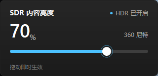

# SDR 内容亮度

一个只做一件事的 Windows 托盘小工具：把「设置 → 系统 → 显示 → HDR → SDR 内容亮度」的滑块放到任务栏右下角。

左键单击托盘图标即可弹出滑块，拖动时立即生效。没有主窗口、没有多余开关，关闭弹窗后继续常驻托盘。



项目主页：<https://github.com/HandRush233/SdrBrightnessTray>

## 功能

- **托盘常驻**：启动后只在通知区域显示一个显示器图标。
- **拖动即调**：0–100 的滑块对应 80–480 尼特，与 Windows 设置中的范围一致；大字显示百分比，旁边显示尼特值。
- **自动读取当前值**：每次打开面板都会读取系统当前值，不覆盖你在 Windows 设置里做的修改。
- **开机自启动**：默认启用，可在右键菜单中随时关闭。写入当前用户的 `Run` 启动项，不需要管理员权限。
- **单实例**：重复启动不会产生第二个图标，只会唤出已经运行的面板。
- **多显示器**：对所有已开启 HDR 的显示器同时生效。

## 安装

1. 保持 `SdrBrightnessTray.exe`、`Install.cmd`、`Uninstall.cmd` 在同一个文件夹。
2. 双击 `Install.cmd`。
3. 右下角出现显示器图标后即可使用。

安装脚本会把程序复制到：

```text
%LOCALAPPDATA%\Programs\SdrBrightnessTray\SdrBrightnessTray.exe
```

并启动程序、启用开机启动。整个过程不需要管理员权限。

也可以直接双击 `SdrBrightnessTray.exe` 便携使用；首次运行时会自动启用开机启动（指向当前 exe 所在位置）。如果之后移动了 exe，再运行一次即可更新启动路径。

## 使用

| 操作 | 效果 |
| --- | --- |
| 左键单击托盘图标 | 打开 / 收起亮度面板 |
| 拖动滑块 | 实时调整 SDR 内容亮度 |
| 鼠标滚轮（指针在滑块上） | 每次 ±1% |
| 方向键 / Page Up / Page Down / Home / End | 键盘微调 |
| 右键托盘图标 → 调整 SDR 亮度 | 打开面板 |
| 右键托盘图标 → 开机自动启动 | 勾选 / 取消开机启动 |
| 右键托盘图标 → 退出 | 完全退出程序 |
| Esc 或点击面板外部 | 收起面板（程序继续常驻） |

> 面板中的滑块只有在 HDR 已开启时才可用。如果显示「HDR 未开启」，请先在 Windows 设置中打开 HDR。

> Windows 11 可能会把新出现的托盘图标收进「隐藏的图标」溢出区。可以在任务栏设置中把它拖到任务栏上，之后就能直接点按。

## 卸载

双击 `Uninstall.cmd`。它会退出程序、删除启动项、删除用户设置和安装目录。

也可以手动清理：

- 删除 `%LOCALAPPDATA%\Programs\SdrBrightnessTray`
- 删除注册表 `HKCU\Software\Microsoft\Windows\CurrentVersion\Run` 中的 `SdrBrightnessTray`
- 删除注册表 `HKCU\Software\SdrBrightnessTray`

## 实现说明

- 使用 Windows 的 `DisplayConfigSetDeviceInfo` 私有包 `DISPLAYCONFIG_DEVICE_INFO_SET_SDR_WHITE_LEVEL`，与系统设置滑块写入的是同一条显示配置路径。
- 显示配置写入被系统拒绝时（例如远程会话或受限环境），会回退到 `dwmapi.dll` 的 `DwmpSDRToHDRBoost`。回退只影响当前会话，Windows 设置页面中的数值可能不会同步；正常本地桌面会优先走持久化路径。
- 读取使用 `DISPLAYCONFIG_DEVICE_INFO_GET_SDR_WHITE_LEVEL`；HDR 状态在 Windows 11 24H2+ 使用 `GET_ADVANCED_COLOR_INFO_2`，旧系统使用 `GET_ADVANCED_COLOR_INFO`。
- 纯 WinForms + P/Invoke，单文件约 90 KB，不联网，不申请管理员权限。

## 从源码构建

要求：Windows 10 1709+ / Windows 11，系统自带 .NET Framework 4.7+（包含 `csc.exe`）。不需要安装 Visual Studio 或 .NET SDK。

```powershell
powershell -ExecutionPolicy Bypass -File .\build.ps1
```

生成结果在 `dist\`。

- `src\`：应用源码
- `assets\app.ico`：应用与托盘图标
- `tools\make_icon.py`：图标生成脚本（正式构建不依赖 Python）
- `build.ps1`：使用系统自带 `csc.exe` 编译
- `Install.cmd` / `Uninstall.cmd`：安装与卸载

## 已知限制

- 依赖未公开的显示配置包，未来的 Windows 版本可能调整其行为；回退路径会尽量保证滑块仍然可用。
- 回退模式下亮度不会写回系统设置，重新打开面板时可能显示系统里旧的值。
- 仅调整 SDR 内容亮度，不提供 HDR 开关、对比度、显示器硬件亮度等其他功能。
